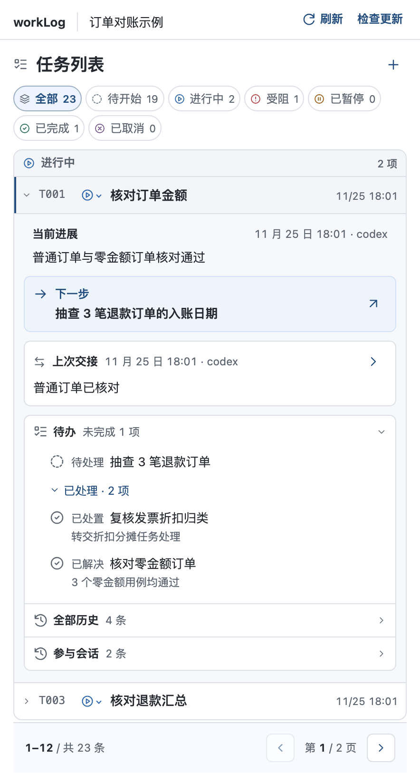

# workLog

[简体中文](README.md)

workLog turns information scattered across your chats with an agent into tasks, to-dos, and progress records you can track. Discuss the work as usual, then ask workLog to pull the agreed action items from the current chat and save them. As work progresses, ask your agent to update the records. This saves time you would spend creating tasks one by one, tracking progress by hand, and repeating context.

## Highlights

- **Find action items in chat.** The agent turns agreed work into tasks and to-dos and lists questions that still need a decision.
- **Track progress by task.** Save results, decisions, updates to to-dos, and next steps under the relevant task. Use the task ID to find its history and evidence of completion later.
- **Keep project data local.** Each project has its own SQLite database in `.worklog/` at the project root. The CLI can run on its own and provides a read-only interface for other tools.

## Installation

Choose an edition and paste its installation prompt into an agent client that can run commands on your computer.

### CLI edition (general-purpose Skill)

Requires macOS or Linux with Python 3.9 or later. Copy the entire block below into your agent chat.

```text
Please install the workLog CLI and its general-purpose Skill on this computer. Download the official installer below, run it with Bash, and tell me whether the installation succeeded and where it was installed.
https://raw.githubusercontent.com/floohubAI/worklog/main/scripts/install-cli.sh
```

The installer verifies the release package and installs the CLI and Skill to `~/.agents/skills/worklog`. If it finds an existing user-level installation, it keeps that version and shows its location. After installation, start a new chat and load the `worklog` Skill. [CLI and Skill release](https://github.com/floohubAI/worklog/releases/tag/v0.4.0) · [Manual installation and upgrades (Chinese)](docs/skill.md)

### GUI edition (Codex desktop)

Requires a Mac with a version of Codex desktop that supports local plugins and Python 3.9 or later. The GUI edition bundles the CLI and Skill and adds a read-only task panel beside your Codex chat.

Copy the entire block below into your Codex chat.

```text
Please install the workLog Codex GUI on this Mac. Download the official installer below, run it with Bash, and tell me whether the installation succeeded.
https://github.com/floohubAI/worklog/releases/download/gui-codex-v0.1.0/install-codex.sh
```

Restart Codex when the installation finishes. [Codex GUI release](https://github.com/floohubAI/worklog/releases/tag/gui-codex-v0.1.0) · [Manual installation (Chinese)](gui/codex/INSTALL.md)

## Getting started

Start a chat from your project's root directory and load the `worklog` Skill. If this is the first time using workLog in the project, say “Initialize workLog for this project.”

### 1. Create a task

- **CLI edition.** Once you've agreed on the work, say “Use workLog to create a task to verify the order amounts we just discussed. Add one to-do for regular orders and another for zero-amount orders.”
- **GUI edition.** Send the same request in Codex. Open the project sidebar as described below and click **Refresh** (`刷新`) to see the new task.

### 2. Update a task

- **CLI edition.** When you have new results, say “Use workLog to update T001.” Replace `T001` with the task ID that workLog returned.
- **GUI edition.** Send the same request in Codex. Once the update is saved, click **Refresh** (`刷新`) in the sidebar to check the progress, to-dos, and next step.

### 3. View a task

- **CLI edition.** Say “Use workLog to show the progress, open to-dos, and next step for T001.” If you don't know the task ID yet, ask “Which tasks are still open in this project?”
- **GUI edition.** In a local Codex chat, open the right sidebar and select **+ → More tools → Plugins and MCP → workLog 项目侧栏** (workLog Project Sidebar). Filter tasks by status and expand a task to see its to-dos and history. [Open the sidebar (Chinese)](gui/codex/INSTALL.md#打开侧栏)



*Codex task sidebar with sample data in the Chinese interface.*

## Documentation

[User guide (Chinese)](docs/user-guide.md) · [CLI reference (Chinese)](docs/cli.md) · [Read-only protocol 2.0 (Chinese)](docs/read-protocol.md) · [Apache 2.0 license](LICENSE)
