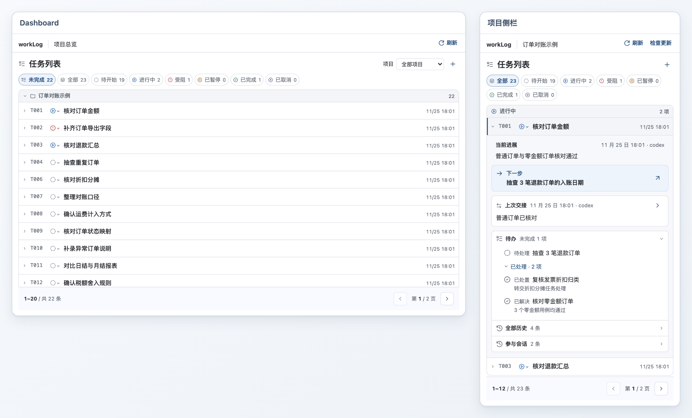

# workLog

[English](README.en.md)

workLog 把和 Agent 聊天时确认的工作整理成任务、待办和进展。你可以让 Agent 保存已确认的事项，在有新结果时更新对应任务，再从另一个聊天读回进度和下一步。

## 项目特色

- **从聊天里提取要做的事**。Agent 根据上下文把已明确的工作整理成任务和待办，并列出需要确认的问题。
- **按任务追踪进展**。把结果、决定、待办的处理情况和下一步记到对应任务上。之后按任务编号就能查回记录和完成依据。
- **记录保存在项目本地**。每个项目都有独立的 SQLite 数据库，位于项目根目录的 `.worklog/`。CLI 可单独使用，并提供只读接口供其他工具查询。

## GUI 0.2.0 和 CLI／Skill v0.5.0 的新功能

- **跨聊天继续任务**。明确授权后，workLog 可以在一个 Codex 聊天跟进一个或多个任务。换到新聊天可以读回进展、待办和阻塞，再保存带来源的成果。整项任务完成仍需单独确认。
- **在两个面板管理阻塞和待办**。Dashboard 和项目侧栏均可设置和逐条解除阻塞，显示待办的「已处置」或「已解决」及说明。补录旧待办时保留原文和原完成依据。
- **分页浏览和筛选**。Dashboard 每页 20 条，项目侧栏每页 12 条。切换筛选会回到第一页，新增任务后定位到新任务所在页。
- **查看原文与升级**。任务历史支持鼠标和键盘展开原文。GUI 安装失败会恢复升级前的插件安装和启用状态。现有 schema 4 项目可继续使用，公开只读协议沿用 2.0。

## 安装

选择一个版本，把对应的安装指令复制到能在本机执行命令的 Agent 客户端。

### CLI 版（通用 Skill）

适用于装有 Python 3.9 或更新版本的 macOS 和 Linux。把下列完整内容复制给你的Agent。

```text
请在这台电脑上安装 workLog CLI 和通用 Skill。请下载下面的官方安装脚本，用 Bash 运行，并告诉我安装结果和安装位置。
https://raw.githubusercontent.com/floohubAI/worklog/main/scripts/install-cli.sh
```

脚本会校验发布包，将 CLI 和通用 Skill 安装到 `~/.agents/skills/worklog`。检测到已有用户级安装时，会显示安装位置并保留原版本。安装后新建聊天并加载 `worklog` Skill。 [CLI／Skill 发布页](https://github.com/floohubAI/worklog/releases/tag/v0.5.0) · [手动安装与升级](docs/skill.md)

### GUI 版（Codex 桌面端）

适用于装有支持本地插件的 Codex 桌面端和 Python 3.9 或更新版本的 Mac。GUI 版随包提供 CLI 和 Skill，并在 Codex 中提供 workLog Dashboard 和项目侧栏。
把下列完整内容复制给你的Codex。


```text
请在这台 Mac 上安装 workLog 的 Codex GUI 版。请下载下面的官方安装脚本，用 Bash 运行，并告诉我安装结果。
https://github.com/floohubAI/worklog/releases/download/gui-codex-v0.2.0/install-codex.sh
```

安装完成后重启 Codex。从主侧栏应用列表打开 **workLog Dashboard**，或在项目的本地聊天右侧打开「workLog 项目侧栏」。 [Codex GUI 0.2.0 发布页](https://github.com/floohubAI/worklog/releases/tag/gui-codex-v0.2.0) · [手动安装](docs/user-guide.md#在-macos-上安装-codex-gui)

## 三个使用场景

先从项目根目录开启聊天，加载 `worklog` Skill。如果项目是第一次使用 workLog，先说「为当前项目初始化 workLog。」

### 1. 新建任务

- **CLI 版**。讨论清楚后，在聊天中说「用 workLog 把刚才确认的订单金额核对建成任务，把核对普通订单和核对零金额订单分别列为待办。」
- **GUI 版**。在 Codex 聊天中发送同样的指令。打开项目侧栏（入口见下方），点「刷新」即可看到新任务。

### 2. 更新任务

- **CLI 版**。有新结果时，说「用 workLog 更新 T001。零金额订单已核对，下一步抽查退款订单。」用 workLog 返回的任务编号替换 `T001`。
- **GUI 版**。在 Dashboard 或项目侧栏点「继续任务」，打开项目管理目录下的可编辑聊天草稿。发送预填草稿即可授权该聊天跟进任务。保存后点「刷新」，查看更新。

### 3. 查看任务

- **CLI 版**。在聊天中说「用 workLog 查看 T001 的进展、未完成的待办和下一步。」还不知道任务编号时，可以先问「当前项目有哪些任务还没结束？」
- **GUI 版**。先打开本地聊天的右边栏，然后选择「＋ → 更多工具 → 插件和 MCP → workLog 项目侧栏」。可以按状态筛选任务，点开任务查看待办和历史记录。 [打开侧栏](docs/user-guide.md#3-在-codex-侧栏查看任务)

## 界面预览

Codex GUI 0.2.0 正式包的 Dashboard 和项目侧栏，使用订单对账示例数据。

[](docs/images/codex-panels.png)

[Dashboard 原图](docs/images/codex-dashboard.png) · [项目侧栏原图](docs/images/codex-task-panel.png)

## 文档

[用户指南](docs/user-guide.md) · [CLI 命令](docs/cli.md) · [只读协议 2.0](docs/read-protocol.md) · [Apache 2.0 许可证](LICENSE)
